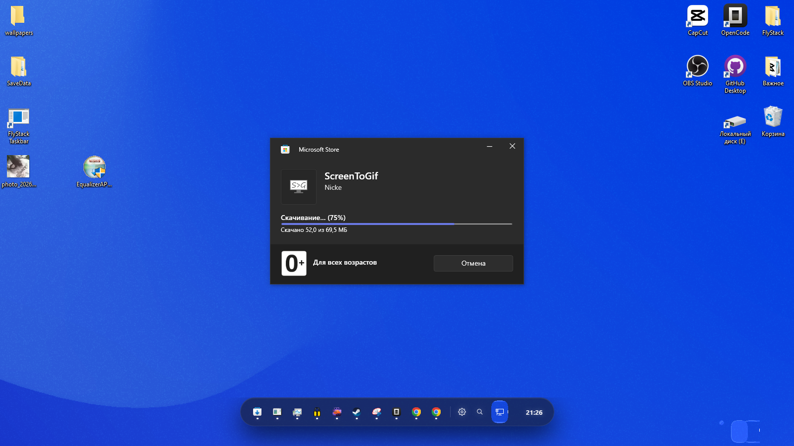
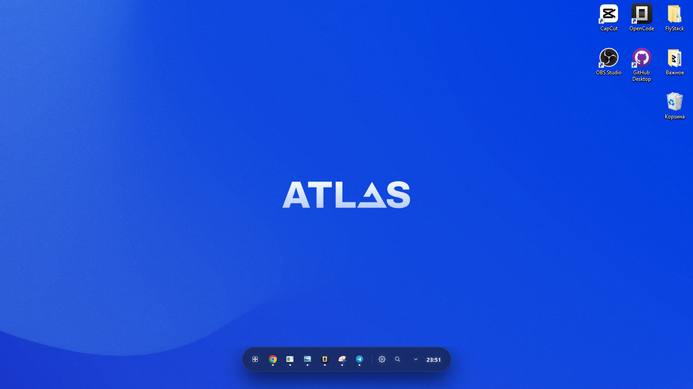

<div align="right">
  <a href="README.md">🇷🇺 Russian</a> | 🇺🇸 <b>English</b>
</div>

<div align="center">

# FlyStack — Custom Taskbar

**A lightweight and fast Windows 10/11 x64 taskbar customizer written in pure C++ and Win32 API.**

</div>

---

> [!NOTE]
> ### Why FlyStack?
>
> - **Native speed.** C++ and Win32 API with minimal dependencies and instant response.
> - **Real system tray.** FlyStack does not emulate tray icons: it hosts the native `TrayNotifyWnd` and leaves Windows notification logic untouched.
> - **Flexible by default.** Adjustable spacing, corners, and taskbar behavior.
> - **Minimal design.** A compact floating capsule that does not cover your desktop.
> - **No extras.** Open source, no ads, no installer.

## Interface and features

### Floating panel and system tray

A compact capsule with active-window indicators, system search, and the native tray inside a styled CSS island:



The tray remains real: `TrayNotifyWnd` is reparented into a transparent Win32 host with `SetParent`/`SetWindowPos`, and `WM_COMMAND` is forwarded to the original parent. On shutdown FlyStack restores the original visibility of the native tray windows.



### Flicker-free calendar

The calendar opens inside a fixed-height container (`CARRIER_HEIGHT_DIP = 640`). Neither the window nor WebView is resized, so the panel does not disappear at the bottom, duplicate at the top, or jitter the desktop.

### MVP highlights

- **Left click** on the FlyStack icon opens or activates the app; **right click** opens the native Win32 menu and never starts the app.
- **Windows search.** The search button sends the system `Win+S` shortcut; no custom index or separate window.
- **Native window previews.** DWM thumbnails with titles appear after about 450 ms of hover and do not intercept clicks.
- **Stable window list.** `Microsoft Text Input Application` (`TextInputHost.exe`/`ctfmon.exe`) is excluded from the list and mode calculation.
- **No icon jitter.** Hover scaling was removed; the DOM is rebuilt only when the actual window set changes.
- **Free screen.** The top-level HWND is clipped by a region to the bottom dock strip and the open flyout only. The rest of the screen stays visible and clickable, with no visible strip and no half-screen overlay.

## Download and run

1. Open **[Releases](../../releases)**.
2. Download `FlyStackTaskbar_MVP_win_x64.zip` and extract it.
3. Run `FlyStackTaskbar.exe`. The program is **portable** and needs no installation.

> [!IMPORTANT]
> `WebView2Loader.dll` must stay next to `FlyStackTaskbar.exe`. You also need the [Microsoft WebView2 Runtime](https://developer.microsoft.com/microsoft-edge/webview2/), which is usually preinstalled.

> [!TIP]
> On first launch Windows SmartScreen may show a warning. This is the standard reaction to unsigned open-source utilities that work with Explorer windows.

To exit, terminate the process normally (for example, Alt+F4 or Task Manager): the standard `Shell_TrayWnd` taskbar will be restored.

## Build from source

You need Visual Studio 2022 or Build Tools with **Desktop development with C++** (v143 toolset, x64).

From the repository root:

```bat
source\build.bat
```

The script locates Visual Studio through `vswhere.exe`, builds `FlyStackTaskbar.exe` in the root, and copies `WebView2Loader.dll` next to it.

## MVP limitations

- This is a session-only taskbar replacement, not an installer or system service.
- Search uses the built-in `Win+S`; FlyStack cannot bypass policies that disable Windows Search.
- Only x64 builds are provided; x86 and ARM64 are not shipped in the MVP.
- Stable operation is guaranteed on original Windows 10/11 images.

## Troubleshooting

<details>
<summary><b>⚠️ Modified Windows builds (AtlasOS, ReviOS, etc.)</b></summary>

Custom builds often remove Explorer components and UWP services. The custom tray may work incorrectly, and in rare cases a failure can occur when calling missing APIs. Use original Windows images.

</details>

<details>
<summary><b>🛠 How to restore the standard taskbar if it disappears</b></summary>

**Windows 11:**

1. Open Task Manager (`Ctrl + Shift + Esc`) and end `FlyStackTaskbar.exe`.
2. Press `Win + R`, type `cmd`, and run:

```cmd
reg delete "HKCU\Software\Microsoft\Windows\CurrentVersion\Explorer\StuckRects3" /f & taskkill /f /im explorer.exe & start explorer.exe
```

**Windows 10:**

1. End `FlyStackTaskbar.exe` in Task Manager.
2. Press `Win + R`, type `cmd`, and run:

```cmd
reg.exe add "HKCU\Software\Classes\CLSID\{86ca1aa0-34aa-4e8b-a509-50c905bae2a2}\InprocServer32" /f /ve
```

</details>

## Changelog

See [CHANGELOG.md](CHANGELOG.md).

## License

MIT. See [LICENSE](LICENSE).
